### `vikram@github ~ $ whoami`

<table>
<tr>
<td valign="top"></td>
<td valign="top"></td>
</tr>
</table>

 

### `vikram@github ~ $ ./contributions.sh`

 

### `vikram@github ~ $ ls projects/`

[JavaScript Projects](https://github.com/vikram-sharma-96/javaScript-Projects) · [My Portfolio](https://github.com/vikram-sharma-96/MY_PORTFOOLIO) · [UAV Engine Digital Twin](https://github.com/vikram-sharma-96/UAV-Engine-Digital-Twin)

Learning, building, and sharing along the way.

<!-- Terminal layout inspired by https://www.avivashishta.com/blog/build-animated-github-profile-readme ; SVGs and scripts created for this profile. -->
